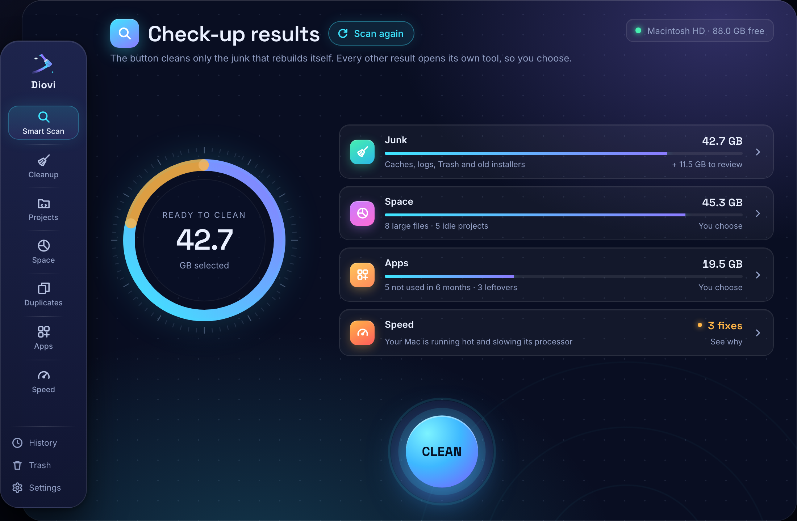
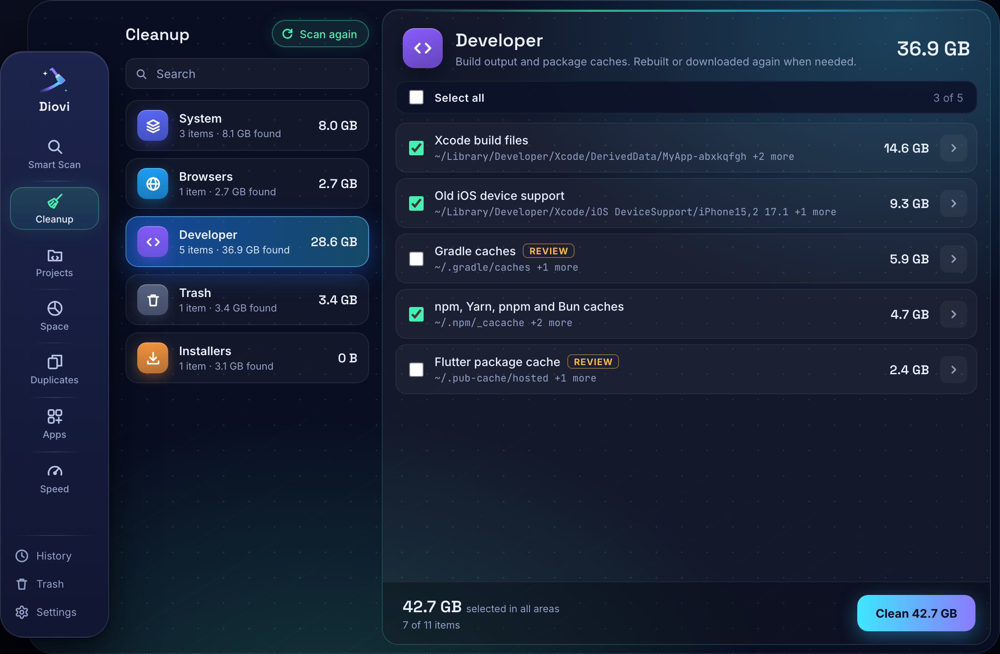
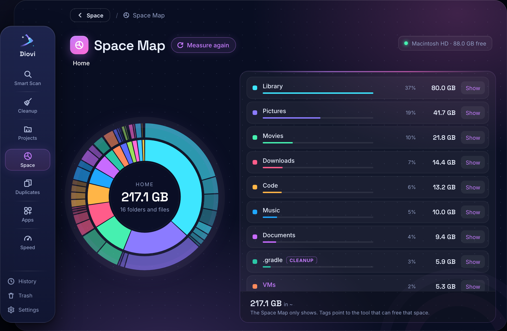
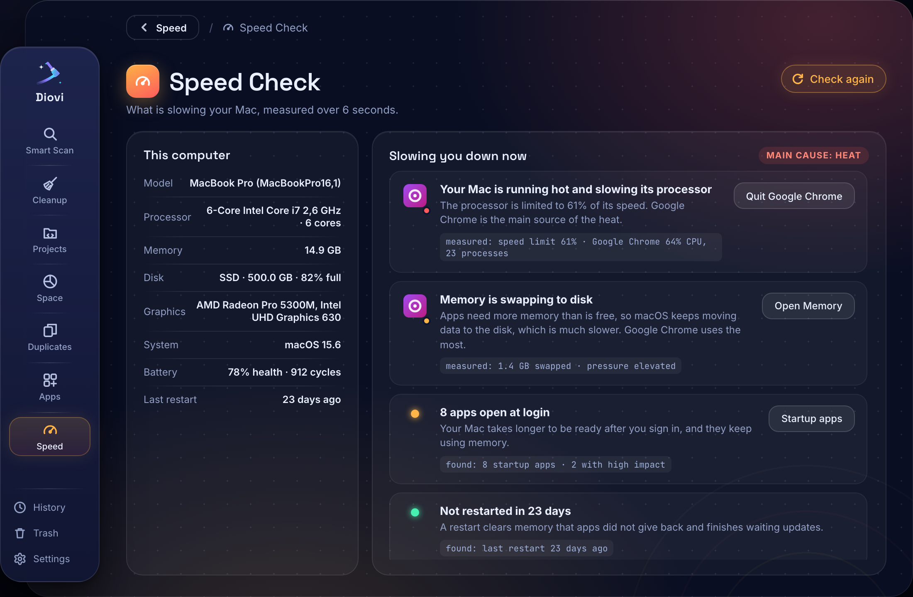
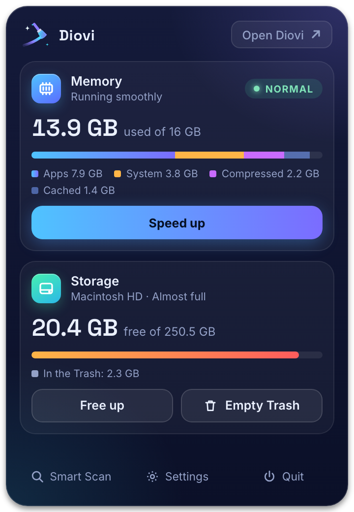

# Diovi

Diovi finds the storage your computer can safely give back (caches, logs, the Trash, developer build leftovers and old installers), shows how much each spot holds, and cleans only what you tick. It also checks why your computer feels slow, manages startup apps and frees up memory.

It runs on **macOS** and **Windows** with the same design, in English or French.

## Screenshots

| | |
| --- | --- |
|  |  |
| **Cleanup.** Tick exactly what goes. Anything that needs a second look is marked *Review*. | **Space Map.** See what fills your disk, folder by folder. It only shows; it never deletes. |
|  |  |
| **Speed Check.** What is slowing your computer right now, with the evidence and a fix for each cause. | **Menu bar.** Memory and storage at a glance, with Speed up, Free up and Empty Trash. |

Screenshots of version 0.5.0 on a Mac, with example numbers. Windows has the same layout with Windows window controls.

## Download

Get the newest version from the **[Releases page](https://github.com/NickAndriam/diovi-releases/releases/latest)**.

| Your computer | File to download |
| --- | --- |
| Mac (Intel or Apple silicon), macOS 11 Big Sur or later | `Diovi_x.y.z_universal.dmg` |
| Windows 10 or 11 (64-bit) | `Diovi_x.y.z_x64-setup.exe` |

Ignore the other files (`.tar.gz`, `.zip`, `.sig`, `.msi`, `latest.json`). They are used by the built-in updater, or by IT admins who need an `.msi`.

## Install

### Mac

1. Open the `.dmg` and drag **Diovi** into **Applications**.
2. Diovi is not code-signed yet, so macOS blocks the first launch. In **Applications**, right-click **Diovi**, choose **Open**, then choose **Open** again.
   On recent macOS versions you may instead need to go to **System Settings → Privacy & Security** and click **Open Anyway**.
3. Optional: some folders (the Trash, Mail attachments, Safari cache) are protected by macOS. To let Diovi clean them, add it in **System Settings → Privacy & Security → Full Disk Access**. Without this, those folders are simply skipped.

### Windows

1. Run `Diovi_x.y.z_x64-setup.exe`. It installs for your user only and does not ask for an admin password.
2. Diovi is not code-signed yet, so SmartScreen may warn you. Click **More info → Run anyway**.

## Updates

Diovi checks this page for new versions and updates itself. Every update is signed, and Diovi refuses any update whose signature does not match. You never need to download a new version by hand.

## Is it safe?

- **A fixed list only.** Diovi never searches your whole disk for things to delete. It only measures a known list of cache and log folders.
- **Your files are off-limits.** Documents, Desktop, Pictures, Movies, Music, iCloud Drive, OneDrive, Mail, Messages and keychains are always refused. In Downloads, only old installers (`.dmg`, `.pkg`, `.exe`, `.msi`) can be removed.
- **Nothing is deleted without asking.** A scan only looks. Cleaning shows the total and waits for you to confirm.
- **Trash first.** By default items go to the Trash or Recycle Bin, so you can put them back. Deleting right away is a choice you make in the confirmation box.
- **Alerts never clean.** Low-disk, memory and weekly check-up alerts only tell you; they never remove anything themselves.
- **No admin password.** System files stay out of reach.
- **Every clean is logged** to `~/Library/Logs/Diovi` on Mac or `%LOCALAPPDATA%\Diovi\Logs` on Windows.

## Uninstall

- **Mac:** quit Diovi from the menu bar icon, then drag **Diovi** from **Applications** to the Trash.
- **Windows:** quit Diovi from the tray icon, then go to **Settings → Apps → Installed apps**, find **Diovi** and choose **Uninstall**.

## Problems or ideas

Open an issue on this repository. It helps to include your Mac or Windows version, the Diovi version (in **Settings → About**), and the log folder above if a clean went wrong.
